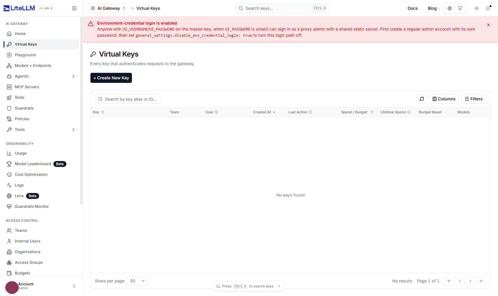
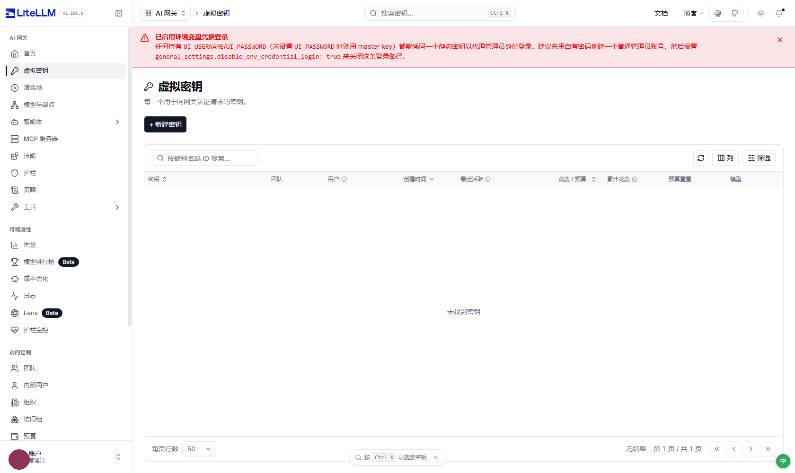

# LiteLLMZh — LiteLLM 控制台汉化

把 [LiteLLM Proxy](https://github.com/BerriAI/litellm) 管理控制台（`/ui`）界面汉化为**简体中文**的
Tampermonkey 用户脚本。纯浏览器侧，只读、零外部依赖、**运行时零网络请求**。

| 英文原界面 | 汉化后 |
|---|---|
|  |  |

## 安装

1. 浏览器安装 [Tampermonkey](https://www.tampermonkey.net/)（或 Violentmonkey 等支持 `@grant none` 的管理器）。
2. 打开 [`litellm-zh.user.js`](litellm-zh.user.js) 点 Raw 安装；或把全文复制到「新建脚本」里保存。
3. 访问你的 LiteLLM 控制台 `http(s)://<你的地址>/ui/`，界面即为中文。

## 作用域与逃生口

默认匹配 `*://*/ui/*`，覆盖任意域名 / 端口下的 LiteLLM 控制台。为避免误伤别的站点的
`/ui` 路径，脚本还会在运行时做一次**站点指纹**确认（只读页面已有信息，不发网络请求）：

- 页面 `title` 含 `LiteLLM`，或
- 存在 `/litellm-asset-prefix/` 静态资源（LiteLLM 的固定资源前缀）

两者都不满足就**静默退出**——不翻译、不加悬浮按钮、不碰页面。

指纹判错时可强制启用：

- URL 上加参数 `?litellm-zh=force`，或
- 控制台执行 `localStorage['litellm-i18n-force']='1'` 后刷新

想只在自己的部署上生效，把脚本头的两行 `@match` 换成你的地址即可。

## 特性

- **白名单整串替换**：只替换词典里有的整串，不做模糊/子串匹配 —— 不会误伤 ID、哈希、模型名、密钥名。
- **按文本节点匹配**：React 常把一句话拆成多个节点，按元素 `textContent` 匹配会漏。
- **随渲染持续生效**：`MutationObserver` 增量补译，切页 / 重渲染不丢。
- **只改展示文本**：改文本节点与 `placeholder`/`title`/`aria-label`/`alt`/`document.title`；
  不改 `value`、不碰表单状态、不动 DOM 结构。
- **完全本地自足**：翻译由脚本内词典 + 正则完成，无 `fetch`/`XHR`/`WebSocket`、
  无 `@require`/`@connect`、不下载远程字体。
- **接近原生中文**：`lang=zh-CN` + 显式中文字体链 + 字距归一。
- 右下角悬浮按钮（`中` / `EN`）可随时开关，状态记在 `localStorage`。

## 不译范围

按设计保留英文：ID / 哈希 / UUID / 模型名 / 密钥名 / 邮箱 / URL / 纯数字；代码块；
产品与厂商名（含云服务、向量库、护栏产品、协议名）；配置值（策略模板 slug、路由策略 id、
环境变量名）；代码标识符（SDK 函数名、HTTP 头、错误类名、快捷键）。
判据是「译了反而不能用或对不上官方文档」。完整术语口径见 [GLOSSARY.md](GLOSSARY.md)。

## 测试

零依赖回归测试（Node 内置模块），锁住几类**不报错只静默失效**的问题，外加一组离线自足断言：

```bash
node tests/test_translate.mjs     # 329 项，全部通过
```

测试直接 `require` 主脚本（脚本尾部有自测钩子，只在 Node 下暴露内部函数），测的是真实实现。

## 与上游的关系

不修改 LiteLLM 源码，只提供前端翻译层。上游为 [BerriAI/litellm](https://github.com/BerriAI/litellm)。

## License

MIT
